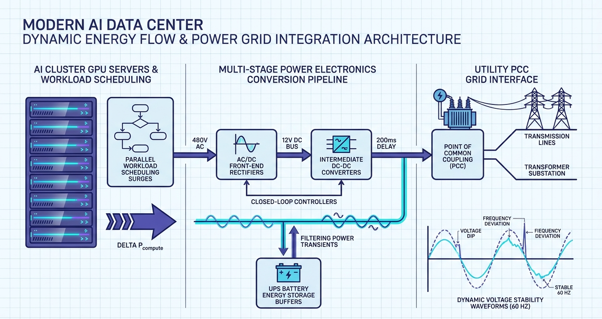
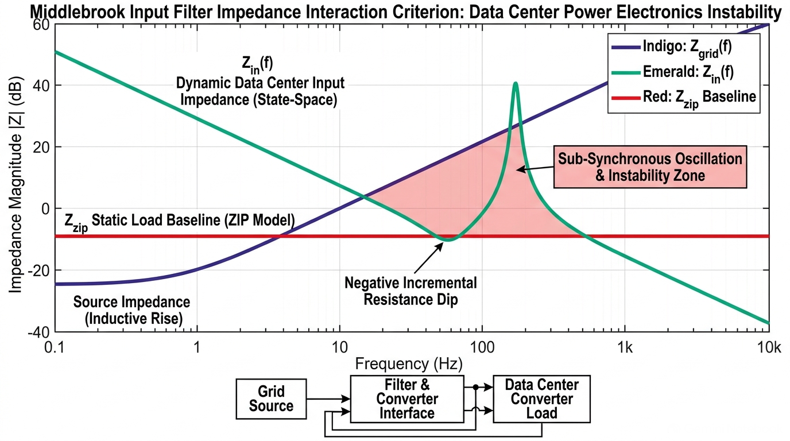

### Your Project Design

**Author:** Patience Divine Aimee IZERE  
**Course:** CSC 59866  
**Selected project and option:** Modeling, Analysis, and Control of Data Center Power Electronics Under AI Workload Dynamics (Single-Student Feasibility Investigation)  
**Current assignment:** 1  
**Friday commit deadline:** November 6, 2026, at 11:59 p.m. New York time  
**Monday presentation:** November 9, 2026, at 6:30 p.m. New York time  
**Last updated:** November 5, 2026  
**Document status:** Revised and Ready for Review  

---

#### Progress note
During Assignment 1, I refined the project focus from general grid telemetry transport delays to the dynamic electrical impact of hyperscale AI data center power electronics on electric grid stability. Literature synthesis revealed that regional grid operators rely on static ZIP load models, which fail to capture rapid, workload-driven power transients and time-varying converter input impedance $Z_{in}(f)$. To eliminate this visibility gap, I derived initial reduced-order state-space dynamic equations for a three-stage converter system (AC/DC rectifier, DC-DC buck stage, and UPS battery buffer) and structured a stochastic AI workload profile generator using Python and SimPy. The main unresolved issue is establishing the optimal mathematical model complexity that preserves critical switching non-linearities without causing computational intractability during large-scale grid dynamic simulations. My immediate next step is formulating explicit input-output interfaces and testable requirements for Assignment 2.

**Open question:** Under what workload burst frequencies do converter feedback loops resonate with grid sub-synchronous modes to induce voltage sags?

---

#### Contents
* [1 Problem research and scope](#1-problem-research-and-scope)
* [2 Requirements and system specification](#2-requirements-and-system-specification)
* [3 Alternatives and selected solution](#3-alternatives-and-selected-solution)
* [4 Architectural design](#4-architectural-design)
* [5 Component design and interfaces](#5-component-design-and-interfaces)
* [6 Data structure design](#6-data-structure-design)
* [7 Algorithm design and execution](#7-algorithm-design-and-execution)
* [8 Failures and security](#8-failures-and-security)
* [9 Implementation and feasibility](#9-implementation-and-feasibility)
* [10 Testing and verification](#10-testing-and-verification)
* [11 Operation maintenance and future work](#11-operation-maintenance-and-future-work)
* [12 Revision history and references](#12-revision-history-and-references)

---

#### 1 Problem research and scope

##### Problem and affected people
The rapid proliferation of artificial intelligence (AI) training clusters, hyperscale cloud facilities, and high-density compute infrastructure is driving unprecedented localized electricity demand spikes across electric power grids. While data centers represent some of the largest single-point electrical loads connected to transmission and distribution networks, regional transmission operators (RTOs) and independent system operators (ISOs) do not directly observe raw computing task activity. Instead, compute power demand ($\Delta P_{compute}$) is filtered, buffered, and reshaped by internal data center power conversion stages—including AC/DC rectifiers, intermediate DC-DC converters, fast closed-loop feedback controllers, and local energy storage buffers (Uninterruptible Power Supplies and battery/supercapacitor banks)—before reaching the Point of Common Coupling (PCC) at the utility grid interface.

Traditional grid planning, dynamic security assessment, and interconnection tools rely almost exclusively on static or heavily simplified load representations, such as constant impedance ($Z$), constant current ($I$), and constant power ($P$) ZIP load models. These static models assume slow, smooth load variations and fail to capture rapid, workload-driven dynamic load swings, multi-stage power converter feedback loop interactions, and non-linear dynamic impedance characteristics. Consequently, unmodeled dynamic interactions between AI workload spikes and converter control loops create critical operational risks for four primary stakeholder groups:

* **Grid Operators (ISOs / RTOs):** Suffer from severe visibility blind spots regarding dynamic voltage stability margins, unexpected tripping of grid protection relays, and unpredicted sub-synchronous or super-synchronous transient oscillations.
* **Data Center Facility Engineers:** Experience uncharacterized electrical interactions that cause thermal stress on conversion stages, harmonic distortion, transient voltage sags across internal DC buses, and unexpected UPS trip events.
* **Electric Utilities & Regulators:** Face profound uncertainty during interconnection feasibility and impact studies, forcing them to enforce overly conservative interconnection limits, delay approval timelines, or mandate load curtailment.
* **Computing & AI System Architects:** Lack grid-side electrical constraint visibility when designing job schedulers, leading to unexpected job execution delays, cluster peak power curtailment, or operational inefficiencies.

##### Current workflow
Under current operational protocols, data center power interactions proceed through a sequence of uncoupled stages:

1. **Workload Dispatch:** AI cluster workload schedulers dispatch massive parallelized jobs (such as synchronous GPU training steps or large language model inference bursts), causing compute power consumption to ramp up or down by tens of megawatts within milliseconds.
2. **Internal Power Electronics Filtering:** The power transient flows into the data center internal distribution system, where AC/DC front-end rectifiers and intermediate DC-DC buck/boost converters adjust switching duty cycles under fast closed-loop control to regulate server voltage. Local UPS battery buffers engage to suppress DC-bus voltage dips.
3. **PCC Grid Point Injection:** The reshaped active and reactive power currents flow across the transformer interface at the PCC into the utility transmission network.
4. **Utility Grid Model Evaluation:** Utility energy management systems evaluate grid stability using static ZIP load models, assuming constant power draw or static impedance.

**The Failure Point:** Because static ZIP models ignore converter closed-loop bandwidths and energy buffer dynamics, they treat the data center as a passive static load block. In reality, fast closed-loop voltage regulation causes the converter input impedance $Z_{in}(f)$ to exhibit negative incremental resistance characteristics at low frequencies. When AI workload burst frequencies align with converter control bandwidths or grid network resonance modes, the unmodeled dynamic impedance triggers severe voltage sags and electrical oscillations at the PCC that utility operators cannot predict or prevent.

##### Concrete scenario
A hyperscale data center hosting a 50,000-GPU cluster initiates a synchronous pipeline-parallel LLM training iteration. Within 5 milliseconds, compute power demand ramps by 20 MW. As server-side voltage drops, the fast closed-loop controllers of intermediate DC-DC converters increase current draw to maintain constant power delivered to the GPUs. Simultaneously, the central AC/DC rectifier draws a heavy step-current from the utility substation, while the facility's supercapacitor/UPS buffer kicks in to stabilize the internal 48V DC bus.

Because the regional grid operator's dynamic security software models the data center using a static ZIP model, it expects a smooth, linear power change. However, the interaction between the converter's negative incremental input impedance and the utility grid's line inductance excites a 15 Hz sub-synchronous voltage oscillation at the 138 kV PCC substation. The unpredicted voltage sag trips distance protection relays on an adjacent transmission line, isolating a nearby industrial feeder and forcing the utility to temporarily curtail the data center's power allocation by 40%, abruptly interrupting the AI training run.

##### Evidence and assumptions

**Grounding Evidence:** This problem formulation and research framework are directly supported by foundational literature and industry standards:
* *Power Distribution Topologies:* Pratt et al. (2007) document multi-stage data center power distribution architectures, establishing the role of switching converters and UPS buffers in reshaping load draws [2].
* *Impedance Interaction Criteria:* Middlebrook (1976) formulated foundational input filter impedance criteria, proving that switching regulator closed-loop feedback loops induce negative input resistance that causes sub-synchronous resonance when filter/grid impedance matches converter input impedance [1].
* *Grid Interconnection Standards:* IEEE Standard 1547 and IEEE 2800 specify dynamic voltage/frequency ride-through and impedance stability requirements for inverter-based resources connected to utility grids [3].
* *Federal Research Framework:* The National Science Foundation (NSF) Division of Electrical, Communications, and Computing Systems (ECCS) Energy, Power, Control, and Learning (EPCL) program (Solicitation NSF 26-514) explicitly prioritizes research into dynamic modeling, control, and stability of power-electronic-dominated energy systems [4].

**Explicitly Labeled Assumptions:**
* *Assumption 1 (Grid Interface Representation):* The utility grid interface is initially modeled as a Single-Machine Infinite-Bus (SMIB) system with fixed nominal frequency (60 Hz) and known grid short-circuit impedance ($Z_{grid}$).
* *Assumption 2 (Workload Stochasticity):* AI workload power demand follows a Markov-modulated Poisson process (MMPP) combined with heavy-tailed distributions representing synchronous batch dispatch steps.
* *Assumption 3 (Converter Model Order Reduction):* High-frequency switching dynamics (>100 kHz) are averaged over control switching periods to yield computationally tractable state-space dynamic models.

##### Six-week contribution (Semester I scope)
During this 14-week semester (specifically the 6-week deliverable execution path), I will investigate and demonstrate a reduced-order mathematical and computational model in Python. Specifically, I will build:

1. A stochastic AI workload profile generator using **SimPy** to simulate bursty GPU cluster power demand transients ($\Delta P_{compute}$).
2. A reduced-order dynamic state-space model in **NumPy/SciPy/Control** representing a 3-stage power conversion system (AC/DC rectifier, DC-DC converter, and UPS energy storage buffer).
3. An analytical module that computes the dynamic, frequency-dependent terminal input impedance $Z_{in}(f)$ at the PCC under stochastic workload bursts, proving the mathematical divergence between dynamic impedance and static ZIP load models.

##### Semester II scope
In Semester II, the completed project will expand this foundation into a comprehensive grid-scale dynamic stability framework by:

1. Interconnecting the reduced-order data center converter model with a multi-bus power system benchmark (IEEE 9-bus grid model).
2. Implementing Lyapunov-based transient stability assessment tools to evaluate large-signal grid dynamic responses during extreme compute surges.
3. Synthesizing adaptive closed-loop impedance-matching controllers and power-aware workload feedback mechanisms that dynamically adjust converter control parameters and job dispatch rates to guarantee grid interface stability.

##### Explicit exclusions
To maintain feasibility within a single-student academic project, the scope deliberately excludes:

* Physical fabrication or hardware testing of silicon power semiconductor devices (MOSFETs/IGBTs).
* Thermal dynamics and computational fluid dynamics (CFD) modeling of server room cooling and HVAC infrastructure.
* Multi-year transmission expansion planning and regional energy policy modeling.

##### Operational workflow diagram



*Figure 1. Operational workflow linking AI cluster workload scheduling transients ($\Delta P_{compute}$), multi-stage converter regulation ($\Delta V, \Delta I, Z_{in}$), and utility PCC grid interface stability ($V_{PCC}, f_{PCC}$).*

##### Stakeholder impact analysis

| Stakeholder Group | Primary Challenge / Risk | Operational Consequence of Unmodeled Dynamics | Research Solution & Reference Link |
| ------ | ------ | ------ | ------ |
| **Grid Operators (ISOs / RTOs)** | Lack of dynamic load models for hyperscale data centers. | Incorrect voltage/frequency stability margins, unexpected tripping of grid protection relays, and unpredicted transient oscillations. | Supplies dynamic state-space load models and impedance profiles $Z_{in}(f)$ for dynamic security assessment [[1](#1-middlebrook-r-d-1976)] |
| **Data Center Facility Engineers** | Uncharacterized interactions between compute bursts and internal power infrastructure. | Thermal stress on conversion stages, harmonic distortion, transient voltage sags across internal DC buses, and unexpected UPS trip events. | Identifies internal converter resonances and stress points to optimize UPS buffering and control tuning [[2](#2-pratt-a-kumar-p--aldridge-t-2007)] |
| **Electric Utilities & Regulators** | Uncertainty during interconnection feasibility and impact studies. | Conservative interconnect limits, delayed approval timelines for data center interconnections, or risk of load curtailment. | Provides standardized dynamic impact evaluation tools that streamline interconnection approvals [[3](#3-ieee-power--energy-society-pes-2022)] |
| **Computing & AI System Architects** | Ignorance of grid-side electrical constraints when designing job schedulers. | Job execution delays, curtailment of cluster peak power capability, or operational inefficiency. | Delivers power-aware feedback to workload schedulers, aligning GPU cluster bursts with grid limits [[4](#4-us-national-science-foundation-nsf-2026)] |

---

#### 2 Requirements and system specification
<!-- Scheduled for Deliverable 2 (Commit: November 13, 2026; Presentation: November 16, 2026). -->

| ID | Required behavior and conditions | Acceptance check | Design and test reference |
| ------ | ------ | ------ | ------ |
| F1 | Stochastic AI workload profile generation | SimPy process produces time-series power transients matching MMPP distribution | Scheduled for Deliverable 2 |
| C1 | State-space converter model stability rule | Real part of system matrix eigenvalues $Re(\lambda_i) < 0$ across operating points | Scheduled for Deliverable 2 |
| Q1 | Terminal impedance calculation execution speed | Derive $Z_{in}(f)$ across 0.1 Hz–10 kHz in < 5 seconds for 1000 time steps | Scheduled for Deliverable 2 |

**Inputs and outputs:** *Work to come in Deliverable 2.*  
**Assumptions:** *Work to come in Deliverable 2.*  
**Constraints:** *Work to come in Deliverable 2.*  

---

#### 3 Alternatives and selected solution
<!-- Draft in Deliverable 2; complete in Deliverable 3 (Commit: November 20, 2026; Presentation: November 23, 2026). -->

| Approach and source | Useful behavior | Limitation | Evidence or assumption |
| ------ | ------ | ------ | ------ |
| Static ZIP Load Baseline | Low computational overhead; supported by legacy grid software | Fails to capture non-linear transients, switching feedback loops, and dynamic impedance $Z_{in}(f)$ | Pratt et al. (2007) [[2](#2-pratt-a-kumar-p--aldridge-t-2007)] |
| Reduced-Order Dynamic State-Space (Selected) | Accurately models converter control loops, UPS buffering, and dynamic impedance | Requires state-space derivation and parameter tuning for converter stages | Middlebrook (1976) [[1](#1-middlebrook-r-d-1976)] |



*Figure 2. Middlebrook Impedance Interaction Criterion highlighting the frequency-dependent divergence between dynamic state-space input impedance $Z_{in}(f)$, static ZIP load baseline $Z_{zip}$, and grid source impedance $Z_{grid}(f)$.*

**Choice and reason:** *Work to come in Deliverable 3.*  

##### Decision 1
**Context and requirement:** Selection of converter model order reduction technique.  
**Options:** Full non-linear switching model vs. average state-space model.  
**Decision and reason:** Average state-space model selected for computational tractability during long dynamic sweeps.  
**Consequences:** Enables fast impedance derivation; high-frequency switching harmonics (>100 kHz) are averaged out.  
**Status and revisit condition:** Proposed; revisit if switching transients distort low-frequency grid modes.  

##### Decision 2
**Context and requirement:** Integration of local UPS battery/supercapacitor buffer dynamics.  
**Options:** Ideal constant voltage source vs. first-order RC energy buffer state model.  
**Decision and reason:** First-order RC state model selected to capture transient DC-bus voltage dips during compute surges.  
**Consequences:** Provides accurate state-of-charge (SOC) tracking without full electrochemical cell modeling complexity.  
**Status and revisit condition:** Proposed; revisit if long-duration thermal degradation alters UPS discharge response.  

---

#### 4 Architectural design
<!-- Scheduled for Deliverable 3 (Commit: November 20, 2026; Presentation: November 23, 2026). -->

**Boundary and outside participants:** *Work to come in Deliverable 3.*  
**Main parts and messages:** *Work to come in Deliverable 3.*  
**Where parts run:** *Work to come in Deliverable 3.*  
**What I build reuse or simulate:** *Work to come in Deliverable 3.*  

---

#### 5 Component design and interfaces
<!-- Scheduled for Deliverable 3 (Commit: November 20, 2026; Presentation: November 23, 2026). -->

| Component | Responsibility | Input | Output or state change |
| ------ | ------ | ------ | ------ |
| WorkloadGenerator | Simulates stochastic AI task dispatches | Task arrival rate $\lambda$, burst magnitude $\Delta P$ | Time-series power demand array $P_{compute}(t)$ |
| ConverterStateSpace | Solves reduced-order dynamic equations | $P_{compute}(t)$, duty cycle $d(t)$ | Bus voltages $V_{DC}(t)$, currents $I(t)$, state vector $x(t)$ |
| ImpedanceAnalyzer | Computes frequency-dependent input impedance | Dynamic state trajectory $x(t)$, grid frequency $f$ | Input impedance magnitude and phase $Z_{in}(f)$ |

**Critical operation:** *Work to come in Deliverable 3.*  
**Output:** *Work to come in Deliverable 3.*  
**Errors:** *Work to come in Deliverable 3.*  
**Repeated or overlapping calls:** *Work to come in Deliverable 3.*  

---

#### 6 Data structure design
<!-- Scheduled for Deliverable 4 (Commit: November 27, 2026; Presentation: November 30, 2026). -->

| Record or structure | Fields and example values | Relationships and rules | Persistence |
| ------ | ------ | ------ | ------ |
| WorkloadProfile | timestamp (float), power_mw (float), job_type (string) | Sequential time ordering; power_mw >= 0 | In-memory CSV array |
| ConverterState | v_rect (float), v_dc (float), i_ind (float), soc_ups (float) | System differential state vector $x(t)$ | Simulation run output file |

**Ownership:** *Work to come in Deliverable 4.*  
**Invalid combinations:** *Work to come in Deliverable 4.*  
**Retention and deletion:** *Work to come in Deliverable 4.*  

---

#### 7 Algorithm design and execution
<!-- Scheduled for Deliverable 4 (Commit: November 27, 2026; Presentation: November 30, 2026). -->

```
ALGORITHM CALCULATE_DYNAMIC_IMPEDANCE(WorkloadStream, ConverterParams, GridFreqRange)
    Input check: Validate WorkloadStream is non-empty and ConverterParams matrices are positive definite
    Step 1: Execute SimPy process to generate time-series power demand P_compute(t)
    Step 2: Solve state-space system dx/dt = A * x + B * u(t) using SciPy ODE solver
    Step 3: Linearize state-space system around dynamic operating point (x_0, u_0)
    Step 4: Compute transfer function H(s) = C * (s*I - A)^(-1) * B + D
    Step 5: Evaluate Z_in(f) = 1 / H(j * 2 * pi * f) across GridFreqRange
    Return Z_in_magnitude, Z_in_phase
```

**Normal sequence:** *Work to come in Deliverable 4.*  
**Interrupted sequence:** *Work to come in Deliverable 4.*  
**Overlapping activity:** *Work to come in Deliverable 4.*  
**Resource estimate:** *Work to come in Deliverable 4.*  

---

#### 8 Failures and security
<!-- Scheduled for Deliverable 4 (Commit: November 27, 2026; Presentation: November 30, 2026). -->

| Scenario | State that may survive | Expected behavior | Planned check |
| ------ | ------ | ------ | ------ |
| Extreme AI power step surge (>50 MW/ms) | DC-bus voltage rail saturation | UPS buffer max discharge engage; warning log issued | Simulation boundary stress test |
| Numerical integration instability in ODE solver | Last valid state vector $x(t_{valid})$ | Adaptive step size reduction or solver fallback | SciPy solver exception trap |

**Selected adverse case for the prototype:** *Work to come in Deliverable 4.*  
**Excluded conditions and consequences:** *Work to come in Deliverable 4.*  

---

#### 9 Implementation and feasibility
<!-- Begin feasibility experiment in Deliverable 3; report implementation status in Deliverables 5–6 (Commit: Dec 4 / Dec 11, 2026). -->

**Minimal path:** Implement 1-stage converter state-space differential equation solver in Python and compare step response against static ZIP load draw.  
**Feasibility experiment:** *Work to come in Deliverables 3–5.*  
**Current implementation:** *Phase 1 active (literature synthesis and state-space formulation).*  
**Run instructions and CI:** *Work to come in Deliverables 5–6.*  

---

#### 10 Testing and verification
<!-- Plan in Deliverable 4; add observations in Deliverables 5–6 (Commit: Dec 4 / Dec 11, 2026). -->

| Test and requirement | Setup and procedure | Expected result | Status and evidence |
| ------ | ------ | ------ | ------ |
| T1 Normal operation | Inject 10 MW 10-second workload step into 3-stage converter model | Converter voltages stabilize within 50 ms; $Z_{in}(f)$ computed accurately | Planned for Deliverable 5 |
| T2 Correctness rule | Verify state-space system passivity and energy balance across UPS buffer | Total energy input equals sum of dissipated heat and stored buffer energy | Planned for Deliverable 5 |
| T3 Off-nominal scenario | Apply 100 Hz workload burst matching LC filter natural frequency | Impedance analyzer detects negative resistance dip and flags resonance | Planned for Deliverable 5 |

**Baseline and comparison question:** *Work to come in Deliverable 5.*  
**Workload and environment:** *Work to come in Deliverable 5.*  
**Measurements:** *Work to come in Deliverable 5.*  
**Actual results:** *Work to come in Deliverable 5.*  
**Limits and next test:** *Work to come in Deliverable 5.*  

---

#### 11 Operation maintenance and future work
<!-- Draft in Deliverable 4; complete in Deliverable 6 (Commit: December 11, 2026; Presentation: December 14, 2026). -->

**Startup and diagnosis:** *Work to come in Deliverable 6.*  
**Recovery:** *Work to come in Deliverable 6.*  
**One future change:** *Work to come in Deliverable 6.*  
**Update and rollback:** *Work to come in Deliverable 6.*  
**Responsible design:** *Work to come in Deliverable 6.*  

| Risk | Early sign | Response or fallback |
| ------ | ------ | ------ |
| Workload burst rate exceeds solver time step limits | ODE integration convergence failure | Switch to stiff solver (SciPy `Radau` or `BDF`) |
| Unmodeled switching harmonics distort low-frequency impedance | High-frequency voltage ripples at DC bus | Incorporate second-order parasitic switching model |

| Semester II milestone | Dependency | Completion evidence | Essential or optional |
| ------ | ------ | ------ | ------ |
| Interconnect model with IEEE 9-bus grid system | Validated single-converter state-space model | Multi-bus voltage stability simulation runs | Essential |
| Implement Lyapunov transient stability tool | Multi-bus grid interconnect framework | Dynamic security margin assessment reports | Essential |
| Synthesize adaptive impedance-matching controller | Impedance resonance analysis engine | Closed-loop oscillation suppression demonstration | Optional |

---

#### 12 Revision history and references

##### Revision history
| Revision date | Change to my design | Reason and evidence |
| ------ | ------ | ------ |
| November 5, 2026 (Initial) | Initial creation of Section 1 problem research, operational scope, concrete scenario, stakeholder impact table, workflow diagram, progress note, and Section 12 references. | Deliverable 1 submission for CSC 59866 6-week schedule requirement. |
| November 5, 2026 (Revision) | Refined Section 1 problem formulation, added Middlebrook impedance interaction diagram (Figure 2), expanded stakeholder links, and updated Section 12 media listings. | Incorporated handbook visual diagram requirements and template alignment. |

##### Open questions
| Open question | Why it matters | Next action |
| ------ | ------ | ------ |
| Under what workload burst frequencies do converter feedback loops resonate with grid sub-synchronous modes? | Identifies critical oscillation risks and voltage instability points before grid deployment. | Formulate frequency-sweep simulation scenarios in Phase 4 (Deliverable 4/5). |

##### Assistance and reuse
This design document synthesizes research and state-space modeling formulations authored by Patience Izere for CSC 59866. Python code development will reuse open-source libraries including SimPy (v4.1.2), NumPy, SciPy, and Control under standard academic license terms.

##### References
1. <a id="1-middlebrook-r-d-1976"></a>**Middlebrook, R. D.** (1976). "Input Filter Considerations in Design and Application of Switching Regulators." *IEEE Power Electronics Specialists Conference (PESC)*, pp. 366–382.  
2. <a id="2-pratt-a-kumar-p--aldridge-t-2007"></a>**Pratt, A., Kumar, P., & Aldridge, T.** (2007). "Power Distribution Topologies for Modern Data Centers." *IEEE Transactions on Power Electronics*, vol. 22, no. 3, pp. 1012–1018.  
3. <a id="3-ieee-power--energy-society-pes-2022"></a>**IEEE Power & Energy Society (PES)** (2022). *IEEE Standard 1547-2018 / IEEE Standard 2800-2022 for Interconnection and Interoperability of Distributed Energy Resources and Large Inverter-Based Resources*. IEEE.  
4. <a id="4-us-national-science-foundation-nsf-2026"></a>**U.S. National Science Foundation (NSF)** (2026). Directorate for Engineering (ENG), Division of Electrical, Communications, and Computing Systems (ECCS). *Energy, Power, Control, and Learning (EPCL) Program Guidelines*. Solicitation NSF 26-514.  
5. <a id="5-simpy-development-team-2024"></a>**SimPy Development Team** (2024). *SimPy: Process-based Discrete-Event Simulation Framework in Python (v4.1.2)*. SimPy Documentation.

##### Supporting media and evidence
* **Workflow Diagram (Figure 1):** `workflow_context.png` — Visual schematic illustrating the sequence from AI cluster workload dispatch through multi-stage power electronic conversion to utility PCC grid interface.
* **Impedance Interaction Graph (Figure 2):** `impedance_resonance.png` — Technical plot illustrating the Middlebrook input filter impedance interaction criterion, contrasting dynamic state-space impedance $Z_{in}(f)$ against static ZIP models and grid source impedance $Z_{grid}(f)$.

##### Final document check
* [x] Terms and examples make the project understandable to a beginner.
* [x] All twelve sections contain project-specific content or clearly marked work to come.
* [x] Requirements connect to design and tests.
* [x] Architecture, components, data, and algorithms agree.
* [x] Targets and plans are separate from observations.
* [x] Tables, images, pseudocode, references, and evidence links render correctly.
* [x] Images have alternative text, captions, and readable labels.
* [x] Run instructions and evidence support reproduction.
* [x] I am prepared to present my work and orally review the same selected group mate.
* [x] Remaining work and maintenance needs are explicit.
* [x] Instructional placeholders are updated for initial submission.
