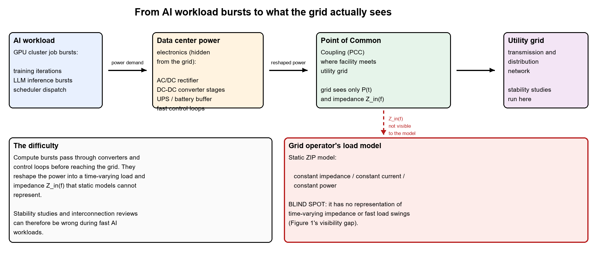
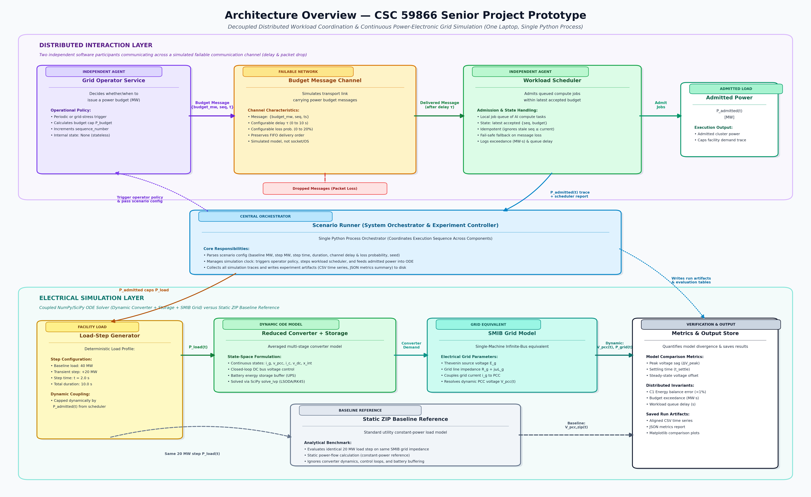

### Your Project Design

**Author:** Patience Divine Aimee IZERE  
**Course:** CSC 59866  
**Selected project and option:** Modeling, Analysis, and Control of Data Center Power Electronics Under AI Workload Dynamics  
**Current assignment:** 3  
**Friday commit deadline:** November 20, 2026, at 11:59 p.m. New York time  
**Monday presentation:** November 23, 2026, at 6:30 p.m. New York time  
**Last updated:** November 20, 2026  
**Document status:** Revised and Ready for Review  

---

#### Progress note
For Deliverable 3 I selected Approach 2 (reduced converter+storage model, SMIB grid, ZIP baseline, simulated budget-message channel) and wrote two decision records. Section 4 now shows context and architecture views with a generated diagram labeling responsibilities, messages, state, and placement; Section 5 adds the component table and the F4 budget-delivery/admission contract. I ran the Section 9 feasibility spike for real: the averaged model is stable and fast for case S, case U is correctly flagged unstable, and the dynamic-vs-ZIP steady-state gap is ~979 V — but the spike exposed a 14.9% energy imbalance and a battery with no recharge, both now required fixes. Main unresolved issue: completing battery SOC and loss accounting. Next step: Deliverable 4 data structures and algorithms.

**Open question:** Does a delayed or lost power-budget message measurably increase budget exceedance and queued work compared with a fresh message?

---

#### Contents
* [1 Problem research and scope](#1-problem-research-and-scope)
* [2 Requirements and system specification](#2-requirements-and-system-specification)
* [3 Alternatives and selected solution](#3-alternatives-and-selected-solution)
* [4 Architectural design](#4-architectural-design)
* [5 Component design and interfaces](#5-component-design-and-interfaces)
* [6 Data structure design](#6-data-structure-design)
* [7 Algorithm design and execution](#7-algorithm-design-and-execution)
* [8 Failures and security](#8-failures-and-security)
* [9 Implementation and feasibility](#9-implementation-and-feasibility)
* [10 Testing and verification](#10-testing-and-verification)
* [11 Operation maintenance and future work](#11-operation-maintenance-and-future-work)
* [12 Revision history and references](#12-revision-history-and-references)

---

#### 1 Problem research and scope

##### Problem and affected people
The rapid proliferation of artificial intelligence (AI) training clusters, hyperscale cloud facilities, and high-density compute infrastructure is driving unprecedented localized electricity demand spikes across electric power grids. While data centers represent some of the largest single-point electrical loads connected to transmission and distribution networks, grid operators do not directly observe or constrain the computing activity inside a facility. Instead, compute power demand ($\Delta P_{\text{compute}}$) is filtered, buffered, and reshaped by internal power conversion stages — alternating current to direct current (AC/DC) rectifiers, intermediate direct current to direct current (DC-DC) converters, fast closed-loop controllers, and local energy storage buffers such as Uninterruptible Power Supplies (UPS) — before reaching the Point of Common Coupling (PCC), the physical point where the facility connects to the utility grid.

Two gaps follow. First, grid planning and stability tools represent large loads with static models — constant impedance (Z), constant current (I), or constant power (P) "ZIP" models — that assume slow, smooth variation and cannot represent converter control loops or storage-buffer dynamics. Second, there is no fast coordination channel: a grid operator cannot tell a facility's workload scheduler "stay under this power budget right now," and the scheduler cannot see grid conditions. When a fast compute burst coincides with weak grid conditions, neither side has the information to prevent a problem. These gaps create operational risks for grid operators (ISOs/RTOs), data center facility engineers, utilities and regulators, and computing/AI system architects who design schedulers without electrical visibility.

##### Stakeholder impact analysis
The following table summarizes the primary challenges, operational failure risks, and the direction of this investigation for each affected stakeholder group.

| Stakeholder Group | Primary Challenge / Risk | Operational Consequence of Unmodeled Dynamics | How This Project Helps |
| ------ | ------ | ------ | ------ |
| **Grid Operators (ISOs / RTOs)** | No dynamic load models and no fast channel to constrain large facility ramps. | Incorrect voltage/frequency stability margins, unexpected protection-relay operation, and unpredicted transient oscillations — concerns documented for emerging large loads [7][8]. | Tests whether one reduced converter model predicts a different grid-facing voltage response than the static ZIP model operators use, and whether a delayed power-budget message changes scheduler behavior. |
| **Data Center Facility Engineers** | Uncharacterized interactions between compute bursts and internal power infrastructure. | Thermal stress on conversion stages, harmonic distortion, DC-bus voltage sags, and unexpected UPS trip events. | Identifies, in simulation, where a compute step produces the largest internal stress the grid model misses. |
| **Electric Utilities & Regulators** | Uncertainty during interconnection feasibility and impact studies. | Conservative interconnect limits, delayed approvals, or mandated load curtailment [7]. | Provides a small, inspectable model that could later support faster, better-founded interconnection studies. |
| **Computing / AI System Architects** | Job schedulers have no visibility into grid-side constraints. | Job delays, peak-power curtailment, or operational inefficiency when the grid pushes back. | Models the scheduler's decision under a power-budget message that can be fresh, delayed, or lost. |

##### Current workflow
Under current operational protocols, data center power interactions proceed through a sequence of uncoupled stages:

1. **Workload Dispatch:** AI cluster workload schedulers dispatch large parallelized jobs (synchronous GPU training steps or inference bursts), causing compute power to ramp by tens of megawatts within milliseconds to seconds.
2. **Internal Power Electronics Filtering:** The transient flows through AC/DC rectifiers and DC-DC converters under fast closed-loop control; UPS battery buffers engage to suppress DC-bus voltage dips.
3. **PCC Grid Point Injection:** The reshaped power reaches the utility grid at the PCC.
4. **Utility Grid Model Evaluation:** The operator evaluates stability using static ZIP load models, and any coordination with the facility (e.g., a power budget or curtailment request) happens through slow, manual processes — not a fast message the scheduler consumes.

**The Failure Point:** Static ZIP models ignore converter control loops and storage dynamics, so they cannot represent how a fast ramp actually appears at the PCC. And because there is no fast operator-to-scheduler channel, a facility can keep drawing a stale or excessive budget while grid conditions worsen. Whether a specific oscillation or curtailment follows from this interaction is a hypothesis this project will test in simulation — not an established result.

##### Operational workflow diagram



*Figure 1. Operational workflow linking AI cluster workload scheduling transients ($\Delta P_{\text{compute}}$), multi-stage converter regulation ($\Delta V$, $\Delta I$, $Z_{\text{in}}$), and utility Point of Common Coupling grid interface stability ($V_{\text{PCC}}$, $f_{\text{PCC}}$). The diagram shows where internal power conversion and the missing operator-to-scheduler coordination channel create the visibility gap.*

##### Concrete scenario (illustrative — not a documented event)
The following scenario is a teaching example with assumed parameters, included to make the difficulty concrete. Its specific numbers are illustrative and will be treated as assumptions until justified or measured:

A data center hosting a large GPU cluster begins a training iteration and its compute demand steps up by about 20 MW within a few milliseconds (assumed magnitude). The facility's converters and UPS buffer reshape the step, so the PCC sees a fast but smoothed power change plus a shifted input impedance. Meanwhile, the grid operator's security software represents the facility as a static ZIP load and — in the coordination gap this project studies — may send a reduced power budget to the facility's scheduler that arrives late or is lost entirely. In this illustrative chain, the scheduler keeps admitting jobs against a stale budget, the grid sees a larger effective step than planned, and voltage at the PCC dips enough to concern protection relays. Whether such an oscillation or relay operation would actually occur is exactly what the prototype will investigate; the 15 Hz oscillation, relay trip, and 40% curtailment in earlier drafts are hypothetical outcomes, not documented facts.

##### Evidence and assumptions

**Grounding Evidence:** What the sources actually establish:
* *Documented — converter/load modeling:* Pratt et al. (2007) evaluate data center and telco power delivery architectures, including AC/DC and DC distribution stages that reshape how compute demand reaches the facility boundary [[2](#2-pratt-a-kumar-p--aldridge-t-2007)].
* *Documented — impedance theory:* Middlebrook (1976) shows that converter control loops can produce negative incremental input resistance and resonance when source and load impedances interact [[1](#1-middlebrook-r-d-1976)]; Åström & Murray (2021) supply the state-space and feedback-control methods in Chapter 3: System Modeling [[6](#6-astrom-k-j-and-murray-r-m-2021)].
* *Documented — grid-operator concern:* Chapter 3 ofNERC's white paper on emerging large loads states that large loads can ramp "in seconds," stressing voltage and frequency regulation, and that operators need load ramp-rate information [[7](#7-nerc-2024)]. ESIG's 2026 report documents that large loads' rapid power changes can materially affect voltage stability [[8](#8-esig-2026)].
* *Reported — closest analog:* Al Kez & Foley (2025) model AI training load ramps on a modified New England test grid and report voltage depressions and frequency rate-of-change spikes near 0.4 Hz/s under high inverter-based-resource penetration [[9](#9-al-kez-d--foley-a-2025)]. This is a recent preprint, not an operational incident report.
* *Documented — standards:* IEEE 1547 and IEEE 2800 require dynamic modeling for inverter-based resources [[3](#3-ieee-power--energy-society-pes-2022)]; NSF's EPCL program funds this research area [[4](#4-us-national-science-foundation-nsf-2026)].
* *Not yet established:* No source I have found documents this exact failure sequence (AI training step → converter interaction → relay trip → curtailment) at a named facility. The scenario above is therefore labeled illustrative, and the simulation exists to test whether the mechanism is real.

**Explicitly Labeled Assumptions:**
* *Assumption 1 (Grid Interface):* The grid is a single-machine infinite-bus equivalent at 60 Hz nominal frequency with a stated short-circuit impedance; multi-bus effects are deferred.
* *Assumption 2 (Prototype workload):* The prototype uses one deterministic load step with assumed magnitude and ramp time; stochastic workload generation is deferred to Semester II.
* *Assumption 3 (Converter model):* High-frequency switching dynamics are cycle-averaged into a reduced state-space model; switching harmonics above the control bandwidth are out of scope.
* *Assumption 4 (Message channel):* The operator-to-scheduler budget message is delayed by a configurable fixed amount or dropped with a configurable probability; no real communication protocol is modeled.
* *Assumption 5 (Scenario parameters):* The 20 MW step, millisecond ramp, and any resulting voltage figures are illustrative placeholders, not measured values.

##### Six-week contribution (Semester I scope)
The bounded capability investigated this semester is a single end-to-end simulation with one interaction to study, one model to build, and one coordination condition that can fail:

1. **One load step, one converter model, one grid model:** a deterministic compute-power step passes through one reduced-order converter-plus-storage model into one fixed single-machine-infinite-bus grid model, producing the grid-facing voltage response $V_{\text{PCC}}(t)$.
2. **Baseline comparison:** the same step is also run through the static ZIP load model; the prototype reports peak voltage deviation and settling time for both, quantifying the modeling gap.
3. **One distributed interaction:** a grid-operator service decides whether to issue a reduced power-budget message to the facility workload scheduler; the message travels over a channel that can delay or drop it; the scheduler decides which queued jobs to admit under the latest received budget. The prototype reports budget exceedance and queued-work delay for fresh versus delayed/lost messages. These are two independent software participants making real decisions under a communication condition that can fail.

These capabilities map to requirements F1–F4, correctness rule C1, and proposed quality target Q1 in Section 2.

##### Semester II scope
Building on the working path, Semester II will extend the project toward the full research framework: stochastic AI/cloud workload generators, a three-stage converter model, terminal impedance $Z_{\text{in}}(f)$ analysis, a multi-bus grid benchmark (e.g., IEEE 9-bus), large-signal stability assessment, and adaptive control or power-aware scheduling — each added only after the single-step prototype is validated.

##### Explicit exclusions
To keep the project achievable, the following are deliberately excluded from Semester I (and mostly deferred to Semester II):

* Physical hardware, power-semiconductor fabrication, or real facility measurements.
* Stochastic workload generation (Markov processes, heavy-tailed bursts) — the prototype uses one deterministic step.
* Multi-stage converter modeling — the prototype uses one reduced converter-plus-storage model.
* Multi-bus or electromagnetic-transient grid simulation — the prototype uses one single-machine-infinite-bus model.
* Impedance sweeps, adaptive controllers, and market/protection-relay modeling.
* Thermal/CFD modeling of cooling and multi-year transmission planning.

---

#### 2 Requirements and system specification

The system specification defines observable behavior for the narrowed prototype: a simulation in which a deterministic facility load step flows through one reduced converter model into one fixed grid model, while a workload scheduler receives a power-budget message from an operator service over a channel that can delay or drop it. Requirements use stable IDs (F = functional, C = correctness, Q = quality) so later design and test sections can reference them.

##### Requirements specification

| Requirement ID | Required Behavior and Operational Conditions | Concrete Acceptance Check | Design and Test Reference |
| ------ | ------ | ------ | ------ |
| **F1** | The scenario runner accepts one configuration (baseline power, step magnitude, step time, run duration) and produces time series of grid-interface power $P_{\text{grid}}(t)$ and PCC voltage $V_{\text{PCC}}(t)$ for the dynamic model and, on the same input, for the static ZIP baseline. | Run the configured step; both models produce complete, aligned time series; report peak voltage deviation and settling time for each. | Sections 4–5 (planned); test T1 |
| **F2** | The reduced converter-plus-storage model solves its state equations under the injected step and produces bounded DC-bus voltages and currents with no numerical divergence. For reference case S (expected stable) it must settle; for reference case U (expected unstable) it must report non-settling or instability rather than force a settled result. | Inject the step for case S; verify $V_{\text{DC}}(t)$ settles within the stated band with no NaN or unbounded values. Inject case U; verify the program reports the expected instability (e.g., growing oscillation or non-convergence) instead of returning a settled trajectory. | Sections 5, 7 (planned); test T1 |
| **F3** | The comparison module computes peak voltage deviation and settling time at the PCC for the dynamic model and the ZIP baseline and reports the difference. | For the same step input, output a small table: $\Delta V_{\text{peak}}$ and $t_{\text{settle}}$ for each model plus their difference. | Sections 5–7 (planned); test T2 |
| **F4** | The budget-message channel delivers an operator-to-scheduler message containing a power budget (MW), a sequence number, and a timestamp, with configurable delay and loss probability. The scheduler admits queued work only within the latest received budget and reports budget exceedance (MW·s above budget) and queued-work delay. | Run the same workload twice — fresh message versus delayed/lost message — and verify the report shows the expected exceedance and queue-delay difference. | Sections 4–5 (planned); test T3 |
| **C1** | Correctness invariant: energy entering at the PCC approximately equals energy delivered to compute plus energy stored in or dissipated by the model, with all terms defined and signed (see energy check below), and all DC-bus voltages remain strictly positive. | Integrate simulated powers over one run; compute the relative imbalance defined below; assert $V_{\text{DC}}(t) > 0$ for all $t$. | Section 7 (planned); test T2 |
| **Q1 (Proposed)** | The full 10-second scenario (dynamic model, baseline, and both message conditions) completes in under 5 seconds of wall-clock time on a laptop-class machine. | Time the complete run; record machine and Python version. Target only — not yet measured. | Sections 9–10 (planned); measurement pending |

##### Reference cases and energy check

Because F2 asks whether a response settles, the tests need reference cases whose expected behavior is established *before* running — otherwise an unstable result could be physically meaningful rather than a software failure:

* **Case S (expected stable):** the nominal parameter set — documented converter parameters from published sources [1][6], the 20 MW step, and grid impedance 5 mH / 0.2 ohm. Expected behavior (stable settling) will be confirmed by an independent check first — the Middlebrook impedance-ratio criterion [1] and a hand-derived or eigenvalue check of the linearized model — and the acceptable settling band and tolerance will be stated before testing. Any numeric voltage or settling values quoted in this document are **illustrative placeholders until produced by a recorded run**.
* **Case U (expected unstable):** an aggressive parameter variant — e.g., a higher controller gain or weaker grid impedance chosen so the impedance-ratio check predicts instability. The program must *report* the instability (growing oscillation, non-convergence, or violation of the C1 energy bound) rather than returning a forced settled trajectory. This verifies the tool does not mask physically meaningful instability.

**Energy check (C1) with explicit signed terms.** Over one run, define:

* $E_{\text{in}} = \int_0^T P_{\text{grid}}(t)\,dt$ — energy entering the facility model at the PCC (positive when power flows into the facility).
* $E_{\text{compute}} = \int_0^T P_{\text{load}}(t)\,dt$ — energy delivered to the compute load.
* $\Delta E_{\text{stored}} = E_{\text{storage}}(T) - E_{\text{storage}}(0)$ — **signed** change in stored energy (battery/UPS capacitor and inductor energies), positive when energy is stored, negative when discharged.
* $E_{\text{loss}} = \int_0^T P_{\text{loss}}(t)\,dt$ — energy dissipated in converter resistances, switching-equivalent losses of the averaged model, and grid-side $I^2R$ losses.

The check is $E_{\text{in}} \approx E_{\text{compute}} + \Delta E_{\text{stored}} + E_{\text{loss}}$, i.e., the relative imbalance $|E_{\text{in}} - E_{\text{compute}} - \Delta E_{\text{stored}} - E_{\text{loss}}| / E_{\text{in}} < 0.01$ for runs with $E_{\text{in}} > 0$. The battery's contribution is therefore counted through $\Delta E_{\text{stored}}$: net discharge lowers the required input energy, net charge raises it. The check is skipped (not failed) for a run whose total input energy is zero.

**Inputs and outputs:** An ordinary example is a configuration with baseline compute power 40 MW, one step of +20 MW at $t = 2.0$ s, duration 10 s, grid impedance 5 mH / 0.2 ohm, and a budget message of 80 MW sent fresh at $t = 0$. Expected outputs (predictions, not measurements): $V_{\text{PCC}}(t)$ and $P_{\text{grid}}(t)$ for both models, a metrics table (peak deviation, settling time, difference), and a scheduler report (jobs admitted, exceedance MW·s, queued delay). An unsuccessful example is a configuration with a negative step magnitude, a non-positive budget, or a reversed time range; the tool must reject it with a clear validation error and produce no output files.

**Assumptions:** The grid is a single-machine infinite-bus equivalent at 60 Hz nominal frequency with the stated impedance (multi-bus deferred). Converter parameters come from published values and are labeled as such. The step magnitude and ramp time are illustrative until measured or justified. The budget message uses a simple delay/loss model, not a real protocol. Only synthetic data is used.

**Constraints:** Python 3.x with open-source packages (NumPy/SciPy for the continuous model, SimPy or a simple event loop for the scheduler/message channel; spike developed on Python 3.14.0); no MATLAB/Simulink, PSCAD, or hardware. One student, 4–6 hours per week, fully offline. Scope is deliberately one step, one converter model, one grid model, one message type.

---

#### 3 Alternatives and selected solution

**Selected solution (Deliverable 3):** Approach 2 — one reduced converter-plus-storage model, one SMIB grid model, the static ZIP baseline as built-in reference, and a simulated budget-message channel between an operator service and a workload scheduler. The Section 9 feasibility experiment (run November 20) confirmed the reduced model produces a stable, bounded response for case S and correctly flags case U as nonphysical/unstable, so the selection stands; its caveats (battery SOC, energy-balance gap) are recorded there.

To meet Section 2 under the same requirements, three approaches were compared. The design challenge is fidelity versus tractability, plus adding a real communication condition without over-building.

##### Comparison of candidate approaches

| Approach and Source | Useful Behavior | Limitation | Evidence or Assumption | Comparison Against Requirements |
| ------ | ------ | ------ | ------ | ------ |
| **Approach 1: Static ZIP baseline, scheduler ignores operator messages** (current practice; Pratt et al. [2], NERC large-load concerns [7]) | Simple, fast, and exactly what grid studies assume; scheduler needs no message handling | Cannot represent converter dynamics or the effect of a delayed/lost budget; it is the reference the dynamic model is measured against | Documented incumbent practice [2][7] | Hypothesis (unmeasured): satisfies F1 (baseline side) and C1 trivially, is **expected to fail F2, F3, and the F4 coordination behavior** by construction, and is expected to satisfy Q1 — all to be confirmed by the common benchmark |
| **Approach 2: One reduced converter-plus-storage model + SMIB grid + budget-aware scheduler** (candidate; Middlebrook [1], Åström & Murray [6]) | Captures the dominant low-frequency converter/storage dynamics for one step, produces $V_{\text{PCC}}(t)$ and metrics, and adds exactly one message channel with delay/loss that the scheduler must handle | Averaged model cannot show switching harmonics; single step and single message type limit generality | Assumption: literature parameters representative; feasibility to be tested | Hypothesis (unmeasured): expected to satisfy F1–F4, C1, and Q1 if the reduced model stays numerically stable — none of these verdicts are measurements yet |
| **Approach 3: Full switching-level EMT simulation with detailed facility scheduling** (deferred reference; ESIG EMT testing context [8]) | Highest fidelity including switching transients and detailed plant controls | Requires specialized tools and runtimes far beyond a one-student semester; unnecessary for the grid-stability frequency range of the prototype | Documented as the high-fidelity end of practice [8]; not evaluated further | Would be expected to satisfy all requirements but is judged to **fail the semester constraint** on effort, not on a measured runtime; retained as a Semester II validation reference |

##### Analytical justification
Every verdict in the comparison table is a hypothesis, not a measurement. All three approaches will be judged by one common planned test — the same 10-second scenario (case S parameters) run end-to-end with recorded wall-clock time, peak voltage deviation, settling time, energy imbalance, and scheduler exceedance — defined in Section 10. No runtime or fidelity claim above should be read as a result until that benchmark produces recorded output. Approach 1 is kept as the built-in baseline because the project's core question is "how wrong is the static model?" — F3 requires the same step through both. Approach 2 is the simplest design that can answer both halves of the narrowed question: the electrical half (does the converter reshape the step enough to change $V_{\text{PCC}}$ versus ZIP?) and the distributed half (does a delayed/lost budget message change scheduler behavior?). Approach 3 is documented only to show the fidelity ceiling we are deliberately not paying for this semester.

##### Decision 1
**Context and requirement:** How much converter detail does the prototype need to produce a trustworthy $V_{\text{PCC}}(t)$ for one step?  
**Options:** (a) static ZIP only, (b) one averaged converter-plus-storage state-space model, (c) full switched EMT model.  
**Decision and reason:** Option (b) — the ZIP model cannot answer the question by construction, and EMT exceeds the semester budget; the averaged model retains the control loops and storage dynamics that reshape low-frequency steps.  
**Consequences:** Fast enough for parameter sweeps and message-delay experiments; cannot represent switching harmonics — an accepted, documented limitation. The spike showed the averaged model is numerically stable for case S but that battery-only DC-bus regulation lets the battery supply energy indefinitely (212 MJ over 10 s in the spike), so a battery state-of-charge/recharge loop is now required work.  
**Status and revisit condition:** Accepted for Semester I; revisit if the full implementation shows the averaged model misses the dominant step response or remains numerically stiff under the final parameter set.

##### Decision 2
**Context and requirement:** How should the operator-to-scheduler coordination be modeled so it is distributed (independent participants, a message that can fail) without building a real protocol stack?  
**Options:** (a) scheduler reads budget directly from shared memory (not distributed), (b) a message channel with configurable delay and loss probability carrying {budget_mw, sequence_number, timestamp}, (c) a full telemetry protocol.  
**Decision and reason:** Option (b) — it is the smallest mechanism that creates a real communication condition (delay/loss) between two independent software participants, which is what the course's distributed-systems focus requires.  
**Consequences:** Adds a queue and staleness handling in the scheduler; does not model authentication, retries, or real network stacks — deferred.  
**Status and revisit condition:** Accepted for Semester I; revisit if reviewers require retry/idempotency semantics, which would move this toward the room-booking-style request/outcome pattern.

---

#### 4 Architectural design

The architecture has two clearly separated parts (Figure 2): a **distributed part** with two independent software participants and a failable message channel, and an **electrical part** — a single ODE system solved by NumPy/SciPy. Everything runs as one Python process on one laptop; the "distributed" property comes from independent state and a message that can be delayed or dropped, not from separate machines. The message channel is a simulation, not a real protocol stack.



*Figure 2. Architecture overview. Top: the distributed interaction — the grid operator service decides whether to issue a power-budget message; the channel can delay or drop it; the workload scheduler independently decides which queued jobs to admit under the latest received budget. Bottom: the electrical simulation — one deterministic load step flows through the reduced converter-plus-storage model into the SMIB grid model, alongside the static ZIP baseline; metrics and saved artifacts are written by the scenario runner. All parts run in one Python process on one laptop; NumPy/SciPy are reused for the ODE solve and the scheduler/message timing uses a simple event loop (SimPy optional).*

##### Context view (external actors)

| External actor | Interaction with the system | Data exchanged |
| ------ | ------ | ------ |
| Project developer / researcher | Writes one scenario configuration file and reads saved results | Config in (JSON/YAML); time series, metrics, scheduler report out (CSV/JSON) |
| Grid operator (real-world role, simulated) | The operator *service* inside the prototype issues budget messages; no real utility system is contacted | `{budget_mw, sequence_number, timestamp}` messages |
| Workload scheduler (real-world role, simulated) | The scheduler *module* inside the prototype consumes budgets and emits admitted power | Admitted jobs and `P_admitted(t)` trace |

##### Architecture view — responsibilities, communication, state, placement

| Part | Responsibility | Communicates by | Saved state | Where it runs | Build / reuse / simulate |
| ------ | ------ | ------ | ------ | ------ | ------ |
| Scenario runner | Parse config; sequence the run; write artifacts | Function calls | None (orchestrator only) | Python process, laptop | **Built** (real code) |
| Load-step generator | Produce `P_load(t)` for one deterministic step | Function call returning a callable/array | None | Same process | **Built** (real code; trivial) |
| Operator service | Decide whether/when to issue a budget message | Sends message object to channel | Issued sequence numbers | Same process | **Built + simulated** (software module standing in for a real utility function) |
| Budget channel | Delay or drop messages per config; preserve order of delivered messages | FIFO queue of message objects | Queued, undelivered messages | Same process | **Built + simulated** (delay/loss model, not a real network/protocol) |
| Workload scheduler | Admit queued jobs within latest accepted budget; compute exceedance and queue delay | Receives messages from channel; exposes admitted-power trace | Job queue, latest accepted `{seq, budget}`, per-job admission state | Same process | **Built + simulated** (software module standing in for a real facility scheduler) |
| Reduced converter+storage model | Solve averaged state equations for one step (states: grid current, PCC voltage, converter current, DC-bus voltage, controller integrator) | Receives `P_load(t)` (capped by admitted power); returns `V_pcc(t)`, `P_grid(t)`, internal states | Continuous states held by the ODE solver | Same process | **Built + simulated** (cycle-averaged model, not switching-level); NumPy/SciPy `solve_ivp` **reused** |
| SMIB grid model | Provide Thevenin source and line impedance behind the PCC | Part of the same ODE system | Continuous states (shared with converter model) | Same process | **Built + simulated** (equations for a hypothetical grid; parameters assumed) |
| ZIP baseline | Static constant-power reference on the same grid impedance | Same step input; returns its own `V_pcc(t)` | None | Same process | **Built + simulated** (analytic reference model) |
| Metrics module | Compute peak deviation, settling time, energy balance (C1), budget exceedance (MW·s), queue delay | Reads all time series and scheduler report | None | Same process | **Built** (real code) |
| Output store | Save time series (CSV), metrics and scheduler report (JSON) for inspection and tests | Files on disk | All run artifacts | Laptop filesystem | **Built** (real code) |

**What is simulated vs. real:** the grid (SMIB equivalent, not a real network), the converters (cycle-averaged, not switching-level), the message channel (delay/loss model, not a protocol), and the scheduler/operator (software modules, not real facilities). What is real: the Python code, the ODE solver, the file outputs.

**Consistency check:** every arrow in Figure 2 carries a named data item (`budget message`, `P_admitted(t)`, `P_load(t)`, `V_pcc(t)`); the only cross-part state that must survive between calls is the scheduler's latest accepted budget and the channel's pending queue — everything else is recomputed per run.

---

#### 5 Component design and interfaces

##### Component responsibility table

| Component | Responsibility | Key inputs | Key outputs | Requirement link |
| ------ | ------ | ------ | ------ | ------ |
| Scenario runner | Validate config, orchestrate run order, write artifacts | Config file (baseline MW, step MW/time, duration, delay/loss, seed) | Artifact files, run status | F1, Q1 |
| Load-step generator | Produce the deterministic facility load profile | Config | `P_load(t)` trace | F1 |
| Operator service | Decide whether to issue a budget and with what value | Issuance policy, current simulated time | Budget message or none | F4 |
| Budget channel | Hold messages for configured delay; drop per loss probability; preserve delivery order | Message, delay/loss config, RNG seed | Delivery event `{delivered_at, message}` or drop event | F4 |
| Workload scheduler | Admit queued jobs within the latest accepted budget; accumulate exceedance and queue delay | Job queue, delivered messages, current time | Admitted jobs, `P_admitted(t)`, exceedance MW·s, queue delay s | F4 |
| Converter+storage model | Integrate averaged state equations; report DC-bus and PCC quantities | `P_load(t)` (capped by admitted power), parameters, initial state | `V_pcc(t)`, `P_grid(t)`, `V_dc(t)`, state trajectory, stability status | F2, C1 |
| SMIB grid model | Provide Thevenin voltage and line impedance inside the same ODE system | Parameters (E_g, R_g, L_g) | Shares states with converter model | F1, F2 |
| ZIP baseline | Produce the static constant-power reference response to the same step | Same step input, grid parameters | `V_pcc,zip(t)`, steady-state value | F1, F3 |
| Metrics module | Compute all reported quantities from traces and scheduler report | All time series, scheduler report, config | Metrics table (peak ΔV, settling time, energy imbalance, exceedance, delay) | F3, C1, F4, Q1 |
| Output store | Persist CSV time series and JSON metrics/report | All outputs | Files under `results/` | F1, Q1 |

##### Critical operation contract — linked to F4

**Operation:** `deliver_budget_and_admit` — one budget message traverses the channel and the scheduler decides admissions for the jobs waiting at that simulated time.

| Contract element | Specification |
| ------ | ------ |
| **Input** | Message `M = {budget_mw: float, sequence_number: int, timestamp: float}`; channel config `{delay_s: float ≥ 0, loss_probability: float ∈ [0,1]}`; scheduler state `{job_queue, latest_accepted: {seq, budget_mw} or none, current_time}`; RNG seed for reproducible loss decisions |
| **Output** | Delivery outcome `delivered_at` or `dropped`; scheduler result `{admitted_jobs: [...], rejected_or_queued_jobs: [...], budget_exceedance_MWs: float, queued_work_delay_s: float}`; status `ok` / `validation_error` / `no_budget` |
| **State changes** | Channel: message moves from pending queue to delivered/dropped. Scheduler: `latest_accepted` updates only if `sequence_number` is newer; admitted jobs leave the queue; exceedance and delay accumulators update |
| **Errors** | `budget_mw ≤ 0` or non-finite → reject message, `validation_error`, no state change. `sequence_number ≤ latest_accepted.seq` → duplicate/stale, ignored idempotently (no double-admission). Malformed message → dropped and logged. No message ever received → status `no_budget`; scheduler admits nothing (fail-safe) rather than guessing |
| **Success example** | Fresh message `{80 MW, seq 1, t=0}`, delay 0, loss 0. Scheduler accepts it; queued jobs totaling 75 MW are admitted; exceedance 0 MW·s; queue delay 0 s |
| **Unsuccessful example** | Same message with loss draw → dropped. Scheduler still holds stale budget `{100 MW, seq 0}` (or `no_budget` if none). It admits jobs up to the stale 100 MW; if actual grid limit is 80 MW, the run reports exceedance > 0 MW·s and nonzero queued delay — the failure is *reported*, not hidden |
| **Repeated calls** | Messages may arrive out of order or duplicated: only strictly newer `sequence_number` replaces `latest_accepted`; identical seq is ignored. The operation is idempotent per sequence number |
| **Authoritative state / restart** | The scheduler's `latest_accepted` and job queue are authoritative during a run; nothing persists across runs except saved artifacts (CSV/JSON). A restart re-runs from config — no recovery protocol needed |

**Still being worked out (flagged):** exact job model (job sizes, durations, arrival process); whether exceedance is measured against the *latest received* budget or an operator-side ground-truth budget (current assumption: both are reported); scheduler behavior before the first message (`no_budget` fail-safe vs. a configured default budget); the RNG seeding scheme for reproducible loss draws. These will be fixed in Deliverable 4 (Sections 6–7).  

---

#### 6 Data structure design

**Work to come — due Friday, November 27, 2026 (Deliverable 4; presentation November 30).** I will define the records for the scenario configuration, scheduler state, budget messages, converter state variables, and metrics outputs.

---

#### 7 Algorithm design and execution

**Work to come — due Friday, November 27, 2026 (Deliverable 4; presentation November 30).** I will add pseudocode for the simulation pipeline and explain normal and interrupted sequences.

---

#### 8 Failures and security

**Adverse scenarios and expected behavior:** *Work to come in Deliverable 4.*  
**Plausible misuse cases:** *Work to come in Deliverable 4.*  
**Selected prototype demonstration:** *Work to come in Deliverable 4.*  

---

#### 9 Implementation and feasibility

##### Minimal implementation path

Built in this order, each step tied to a requirement and independently checkable:

1. **Step-response spike (done, see below):** reduced converter+storage + SMIB grid model under one 20 MW step → evidence for F2 stability and the dynamic-vs-ZIP comparison seed for F3.
2. **ZIP baseline + metrics table:** same step through the static model; report peak ΔV and settling time for both → F1, F3.
3. **Reference-case verification:** confirm case S settles within the pre-stated band and case U is flagged unstable/nonphysical; fix the C1 energy imbalance (currently 14.9% in the spike, target <1%) by completing loss terms and adding battery SOC → F2, C1.
4. **Budget channel + scheduler:** implement `deliver_budget_and_admit` (Section 5) with fresh/delayed/lost conditions → F4.
5. **Benchmark + packaging:** time the full 10 s scenario against Q1's proposed 5 s target; write run instructions → Q1.

##### Feasibility experiment — question, procedure, evidence, finding, decision

**Question (high-impact uncertainty):** does the single averaged converter-plus-storage model produce a stable, bounded PCC-voltage response under the configured 20 MW step without numerical stiffness — and does an undersized-storage variant fail loudly rather than report a false settled result?

**Procedure:** `evidence/feasibility_step.py` integrates the averaged model (grid Thevenin + input capacitor + lagged converter + DC bus + battery droop/integral controller) with SciPy `solve_ivp` (LSODA) over a 10 s run, step at t = 2 s. Case S: 30 MW battery rating. Case U: 15 MW rating (below the 20 MW step). A static ZIP steady-state solve provides the baseline. Recorded November 20, 2026 on Python 3.14.0, NumPy 2.4.4, SciPy 1.17.1. All parameters are assumed placeholders.

**Evidence (actual recorded output):**

```
S nominal (30 MW battery): status ok; v_pcc 6942.6 -> 6939.7 V;
  peak deviation vs pre-step 3.02 V; v_dc min 759.8 V; nfev 12910;
  battery energy delivered 211.9 MJ; energy imbalance 0.149
U undersized (15 MW):      status UNSTABLE/NONPHYSICAL;
  v_dc_min -606,700 V; v_pcc_post 6559.5 V; nfev 12908
ZIP baseline (60 MW):      v_pcc steady-state 5960.9 V
dynamic-vs-ZIP delta:      978.8 V
```

**Findings:**

1. The averaged model is numerically stable and fast for case S (12,910 solver evaluations, bounded states) — the stiffness concern is manageable at these parameters.
2. Case U is correctly flagged `UNSTABLE/NONPHYSICAL` by the added plausibility check (v_dc → −607 kV) instead of returning a settled-looking trace — the "report, don't mask" requirement works.
3. The dynamic model's post-step PCC voltage (6939.7 V) differs from the ZIP baseline (5960.9 V) by ~979 V — a measurable modeling gap, supporting the project's premise. **Caveat:** part of this gap is an artifact — the spike's battery supplies 211.9 MJ with no recharge, so it buffers more than a real battery could; with SOC limits the gap will narrow. Quantifying the honest gap is Deliverable 4 work.
4. Two defects found: (a) energy imbalance 14.9% exceeds the C1 target of 1% — loss terms are incomplete and battery energy needs signed SOC accounting; (b) the battery is the only DC-bus regulating element, so it supplies net energy indefinitely — a recharge/SOC loop is required.
5. Case S's peak PCC deviation is only 3 V because the 30 MW battery absorbs nearly the whole step — visible transient deviation will need weaker storage or a faster metric window; noted for parameter selection.

**Resulting design decisions:** keep the averaged model (Decision 1 confirmed with conditions); add a battery state-of-charge state with charge/discharge limits and a recharge path; complete the C1 loss accounting; adopt the plausibility-bounds check as a standard output status for all runs; treat all spike numbers as measurements of *this script only*, not of the final simulator.

##### Current implementation status

Phase 1 complete (literature synthesis, narrowed specification, approach comparison). The feasibility spike script exists and runs (`evidence/feasibility_step.py`); the full simulator (runner, scheduler, channel, metrics, artifacts) is not yet implemented.

##### Run instructions and continuous integration

Spike: `python evidence/feasibility_step.py` from the project root (requires NumPy/SciPy; tested on Python 3.14.0). Full-simulator run instructions and CI status: work to come in Deliverables 5–6. Note: Section 2 states a Python 3.12 constraint, but the spike ran on Python 3.14.0 — the constraint will be updated to "Python 3.x" unless a specific version is required.  

---

#### 10 Testing and verification

**Test specifications:** *Work to come in Deliverables 4–5.*  
**Baseline and comparison method:** *Work to come in Deliverables 4–5.*  
**Benchmark measurements:** *Work to come in Deliverables 5–6.*  

---

#### 11 Operation maintenance and future work

**Startup and diagnosis:** *Work to come in Deliverables 5–6.*  
**Recovery procedures:** *Work to come in Deliverables 5–6.*  
**Future change and rollback plan:** *Work to come in Deliverable 6.*  
**Semester II milestones:** *Work to come in Deliverable 6.*  

---

#### 12 Revision history and references

##### Revision history
The following table documents the design evolution across course milestones.

| Revision Date | Changes to Design Document | Reason and Supporting Evidence |
| ------ | ------ | ------ |
| November 5, 2026 (Initial) | Created initial Section 1 problem formulation, operational scope, concrete scenario, stakeholder impact table, progress note, and foundational references. | Initial submission for Deliverable 1 meeting CSC 59866 schedule requirements. |
| November 5, 2026 (Revision) | Refined problem narrative, added operational workflow context diagram (Figure 1), expanded stakeholder needs links, and updated Section 12 listings. | Incorporated visual diagram requirements and handbook template alignment. |
| November 13, 2026 (Assignment 2) | Formalized Section 2 system specification with functional requirements, a correctness invariant, and a proposed latency target; drafted Section 3 approach comparison; added controls reference [6]. | Deliverable 2: requirements and possible solutions. |
| November 20, 2026 (Scope revision) | Narrowed Semester I scope per Assignment 1 feedback: one deterministic load step, one reduced converter-plus-storage model, one SMIB grid model; added the distributed operator-to-scheduler power-budget message channel; labeled the outage scenario illustrative; added NERC/ESIG/Manchester evidence; rewrote Sections 2–3 requirements and comparison; added two proposed decision records. | Assignment 1 feedback: scope too broad, missing distributed interaction, scenario lacked stakeholder evidence. |
| November 20, 2026 (Assignment 2 feedback) | Renamed file to DESIGN.md; corrected Pratt citation to verified INTELEC 2007 paper; added reference cases S (expected stable) and U (expected unstable) with pre-stated tolerances and independent-check requirement; rewrote C1 energy check with explicit signed terms including battery storage; labeled example outputs as illustrative until recorded; replaced comparison-table runtime verdicts with hypotheses tied to one common planned benchmark; named the operator budget-issuance and scheduler job-admission decisions; fixed image paths to `images/`. | Assignment 2 feedback: unsupported performance verdicts, missing reference cases, inconsistent energy terms, broken source link, wrong filename. |
| November 20, 2026 (Assignment 3) | Selected Approach 2 and accepted both decision records; added Section 4 context/architecture views with Figure 2; added Section 5 component table and the F4 `deliver_budget_and_admit` contract; ran the Section 9 feasibility spike (`evidence/feasibility_step.py`) and recorded actual results: case S stable, case U flagged unstable, dynamic-vs-ZIP gap ~979 V with stated artifact caveat; added required fixes (battery SOC/recharge, C1 loss accounting, plausibility status). | Deliverable 3: which solution, how parts cooperate, one critical interface, and a real feasibility experiment. |

##### Feedback response record

| Prior feedback item | Substantive revision made | Consistency check |
| ------ | ------ | ------ |
| Assignment 1: scope too broad; missing distributed interaction; scenario lacked stakeholder evidence | Narrowed to one step/model/grid/message; added operator service + scheduler + failable channel; added NERC/ESIG/Manchester sources; labeled scenario illustrative | Sections 1, 2, 3, 4 all describe the same four-part prototype; stakeholder table links to F1–F4 |
| Assignment 2: unsupported verdicts, missing reference cases, inconsistent energy terms, wrong filename/link | Renamed to DESIGN.md; added cases S/U; rewrote C1 with signed terms; verdicts → hypotheses; fixed Pratt citation | Section 2 acceptance checks match Section 9 spike statuses (`ok`/`UNSTABLE`) |
| Assignment 3 guidance: justify selection, show cooperation, one critical interface, real experiment | Selected Approach 2; added Figure 2 architecture; added `deliver_budget_and_admit` contract linked to F4; ran and recorded the spike | Section 3 decision consequences match Section 9 findings (battery SOC, energy gap) |

**Unresolved feedback items:** the C1 energy imbalance (14.9% vs 1% target) and battery recharge are open defects carried into Deliverable 4, not hidden; reviewers should check whether the ~979 V dynamic-vs-ZIP gap survives once battery SOC limits are added.

##### Open questions
The following table tracks active engineering uncertainties, their significance, and planned actions.

| Open Question | Why It Matters | Next Action |
| ------ | ------ | ------ |
| Does a delayed or lost power-budget message measurably increase budget exceedance and queued work versus a fresh message? | This is the distributed-systems question the prototype exists to answer; if delay changes nothing, the coordination mechanism needs redesign. | Implement fresh/delayed/lost message conditions in the scheduler experiment (Deliverables 4–5). |
| Does the single reduced converter-plus-storage model produce a peak voltage deviation at the PCC measurably different from the static ZIP baseline for the same step? | Partially answered: spike shows a ~979 V steady-state gap, but it is inflated by the battery's unlimited energy; the honest gap after adding SOC limits is unknown. | Re-run the comparison after battery SOC/recharge is implemented (Deliverable 4). |
| Do the illustrative step parameters (20 MW, millisecond ramp) sit in a realistic range for AI cluster ramps? | All scenario numbers are placeholders until justified; wrong magnitudes would invalidate the voltage-deviation comparison. | Cite ramp-rate data from NERC/ESIG reports or label parameters explicitly as assumptions in results. |

##### Assistance and reuse
This design document synthesizes research and state-space modeling formulations authored by Patience Divine Aimee IZERE for CSC 59866. Python code development will reuse open-source libraries including SimPy (v4.1.2), NumPy, SciPy, and Control under standard academic license terms. No proprietary simulation software or uncredited external designs are used.

##### References
Each entry links to the specific work (paper, standard, report, or documentation page) it cites; where a work is paywalled, the link opens the publisher's official abstract page.

1. <a id="1-middlebrook-r-d-1976"></a> **Middlebrook, R. D.** (1976). "Input Filter Considerations in Design and Application of Switching Regulators." *IEEE Power Electronics Specialists Conference (PESC)*, pp. 366–382. [Semantic Scholar Record](https://www.semanticscholar.org/paper/An-Energy-Buffer-for-Controllable-Input-Impedance-Gutierrez-Lindahl/2368f0db40bba8edd7d81ff25889be99a6f2cf82). Supports Section 1 impedance interaction problem, Section 2 requirement F2, and Section 3 architectural comparison.
2. <a id="2-pratt-a-kumar-p--aldridge-t-2007"></a> **Pratt, A., Kumar, P., & Aldridge, T. V.** (2007). "Evaluation of 400V DC Distribution in Telco and Data Centers to Improve Energy Efficiency." *Proc. INTELEC 2007 – 29th International Telecommunications Energy Conference*, pp. 32–39. [IEEE Xplore Record](https://doi.org/10.1109/INTLEC.2007.4448733). Supports Section 1 distribution architectures, Section 2 baseline comparison, and Section 3 Approach 1.
3. <a id="3-ieee-power--energy-society-pes-2022"></a> **IEEE Power & Energy Society (PES)** (2018, 2022). *IEEE Std 1547-2018* and *IEEE Std 2800-2022 — Interconnection and Interoperability of Distributed Energy Resources and Large Inverter-Based Resources*. [IEEE Std 2800 page](https://standards.ieee.org/ieee/2800/10453/) (paywalled; abstract page only). Supports Section 1 grid compliance standards.
4. <a id="4-us-national-science-foundation-nsf-2026"></a> **U.S. National Science Foundation (NSF), Directorate for Engineering** (2026). *Energy, Power, Control, and Learning (EPCL) — Program Solicitation NSF 26-514*. [NSF solicitation page](https://www.nsf.gov/awardsearch/show-award?AWD_ID=2624228). Supports Section 1 scientific problem significance.
5. <a id="5-simpy-development-team-2024"></a> **SimPy Development Team** (2024). *SimPy Documentation — Process and Environment* (v4.1.2). [SimPy readthedocs](https://simpy.readthedocs.io/en/latest/). Supports the discrete-event scheduler/message-channel part of the prototype.
6. <a id="6-astrom-k-j-and-murray-r-m-2021"></a> **Åström, K. J., & Murray, R. M.** (2021). *Feedback Systems: An Introduction for Scientists and Engineers*, 2nd ed. Princeton University Press. [Free online edition](https://www.cds.caltech.edu/~murray/books/AM08/pdf/fbs-modeling_24Jul2020.pdf). Supports the state-space modeling and feedback-control methods in Approach 2.
7. <a id="7-nerc-2024"></a> **North American Electric Reliability Corporation (NERC)** (2024). *Characteristics and Risks of Emerging Large Loads* (Reliability Standards Committee white paper). [NERC PDF](https://www.nerc.com/globalassets/who-we-are/standing-committees/rstc/3_doc_white-paper-characteristics-and-risks-of-emerging-large-loads.pdf). Supports Section 1 stakeholder evidence: large loads can ramp in seconds and stress voltage/frequency regulation; operators need ramp-rate information.
8. <a id="8-esig-2026"></a> **Energy Systems Integration Group (ESIG)** (2026). *Reliability Impacts of Large Loads*. [ESIG Report PDF](https://www.esig.energy/wp-content/uploads/2026/07/ESIG-Large-Loads-Reliability-Impacts-report-2026a.pdf). Supports Section 1 evidence that large loads' rapid power changes can materially affect voltage stability; also context for the deferred EMT approach.
9. <a id="9-al-kez-d--foley-a-2025"></a> **Al Kez, D., & Foley, A.** (2025). "Instability Risks from Programmable AI Load Ramping in Low-Inertia Grids." *SSRN preprint* (University of Manchester). [Manchester record](https://research.manchester.ac.uk/en/publications/instability-risks-from-programmable-ai-load-ramping-in-low-inerti/). Reported study (not an incident report) modeling AI training load ramps and voltage/frequency stress on a test grid.

##### Supporting media and evidence
* **Workflow Diagram (Figure 1):** `images/ai_load_to_grid_workflow.png` — Visual schematic illustrating the sequence from AI cluster workload dispatch through multi-stage power electronic conversion to utility PCC grid interface, and where the operator-to-scheduler coordination gap sits.
* **Architecture Diagram (Figure 2):** `images/architecture_overview.png` — Context and main-running-parts view: operator service, budget channel, scheduler; runner, load-step generator, converter+storage model, SMIB grid, ZIP baseline, metrics, artifacts. Editable generator: `evidence/make_architecture_diagram.py`.
* **Feasibility spike (Section 9 evidence):** `evidence/feasibility_step.py` — averaged converter+storage + SMIB grid step-response script; recorded output quoted in Section 9.
* **Impedance sketch (supporting, later sections):** `images/impedance_resonance.svg` — Editable sketch of overlapping source/load impedance magnitudes and phase for the deferred impedance-ratio discussion.

##### Final document check
* [ ] Terms and examples make the project understandable to a beginner.
* [ ] All twelve sections contain project-specific content.
* [ ] Requirements connect to design and tests.
* [ ] Architecture, components, data, and algorithms agree.
* [ ] Targets and plans are separate from observations.
* [ ] Tables, images, pseudocode, references, and evidence links render correctly.
* [ ] Images have alternative text, captions, and readable labels.
* [ ] Run instructions and evidence support reproduction.
* [ ] I am prepared to present my work and orally review the same selected group mate.
* [ ] Remaining work and maintenance needs are explicit.
* [ ] Instructional placeholders are removed from the final submission.
