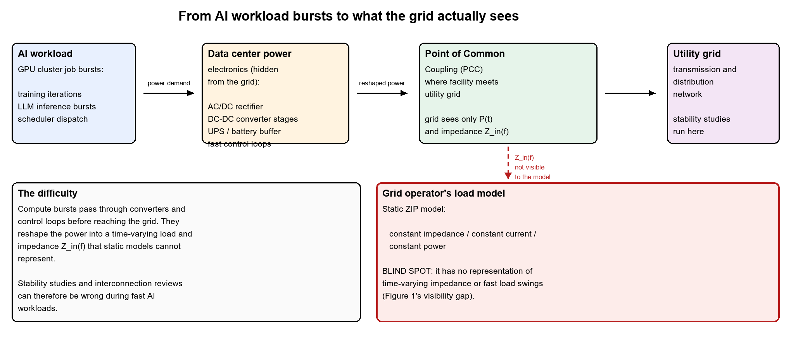

### Your Project Design

**Author:** Patience Divine Aimee IZERE  
**Course:** CSC 59866  
**Selected project and option:** Modeling, Analysis, and Control of Data Center Power Electronics Under AI Workload Dynamics
**Current assignment:** 1  
**Friday commit deadline:** November 6, 2026, at 11:59 p.m. New York time  
**Monday presentation:** November 9, 2026, at 6:30 p.m. New York time  
**Last updated:** November 5, 2026  
**Document status:** Revised and Ready for Review  

---

#### Progress note
During Assignment 1, I refined the project focus from general grid telemetry transport delays to the dynamic electrical impact of hyperscale AI data center power electronics on electric grid stability. Literature synthesis revealed that regional grid operators rely on static ZIP load models, which fail to capture rapid, workload-driven power transients and time-varying converter input impedance $Z_{in}(f)$. To eliminate this visibility gap, I derived initial reduced-order state-space dynamic equations for a three-stage converter system (AC/DC rectifier, DC-DC buck stage, and UPS battery buffer) and structured a stochastic AI workload profile generator using Python and SimPy.

The main unresolved issue is establishing the optimal model complexity that preserves critical switching non-linearities without causing computational intractability in grid-scale simulations. My next step is defining interfaces and testable requirements for Assignment 2.

**Open question:** Under what workload burst frequencies do converter feedback loops resonate with grid sub-synchronous modes to induce voltage sags?

---

#### Contents
* [1 Problem research and scope](#1-problem-research-and-scope)
* [2 Requirements and system specification](#2-requirements-and-system-specification)
* [3 Alternatives and selected solution](#3-alternatives-and-selected-solution)
* [4 Architectural design](#4-architectural-design)
* [5 Component design and interfaces](#5-component-design-and-interfaces)
* [6 Data structure design](#6-data-structure-design)
* [7 Algorithm design and execution](#7-algorithm-design-and-execution)
* [8 Failures and security](#8-failures-and-security)
* [9 Implementation and feasibility](#9-implementation-and-feasibility)
* [10 Testing and verification](#10-testing-and-verification)
* [11 Operation maintenance and future work](#11-operation-maintenance-and-future-work)
* [12 Revision history and references](#12-revision-history-and-references)

---

#### 1 Problem research and scope

##### Problem and affected people
The rapid proliferation of artificial intelligence (AI) training clusters, hyperscale cloud facilities, and high-density compute infrastructure is driving unprecedented localized electricity demand spikes across electric power grids. While data centers represent some of the largest single-point electrical loads connected to transmission and distribution networks, regional transmission operators (RTOs) and independent system operators (ISOs) do not directly observe raw computing task activity. Instead, compute power demand ($\Delta P_{compute}$) is filtered, buffered, and reshaped by internal data center power conversion stages, including AC/DC rectifiers, intermediate DC-DC converters, fast closed-loop feedback controllers, and local energy storage buffers (Uninterruptible Power Supplies and battery/supercapacitor banks), before reaching the Point of Common Coupling (PCC) at the utility grid interface.

Traditional grid planning, dynamic security assessment, and interconnection tools rely almost exclusively on static or heavily simplified load representations, such as constant impedance ($Z$), constant current ($I$), and constant power ($P$) ZIP load models. These static models assume slow, smooth load variations and fail to capture rapid, workload-driven dynamic load swings, multi-stage power converter feedback loop interactions, and non-linear dynamic impedance characteristics. Consequently, unmodeled dynamic interactions between AI workload spikes and converter control loops create critical operational risks for four primary stakeholder groups:

##### Stakeholder impact analysis

| Stakeholder Group | Primary Challenge / Risk | Operational Consequence of Unmodeled Dynamics | Research Solution & Reference Link |
| ------ | ------ | ------ | ------ |
| **Grid Operators (ISOs / RTOs)** | Lack of dynamic load models for hyperscale data centers. | Incorrect voltage/frequency stability margins, unexpected tripping of grid protection relays, and unpredicted transient oscillations. | Supplies dynamic state-space load models and impedance profiles $Z_{in}(f)$ for dynamic security assessment [[1](#1-middlebrook-r-d-1976)] |
| **Data Center Facility Engineers** | Uncharacterized interactions between compute bursts and internal power infrastructure. | Thermal stress on conversion stages, harmonic distortion, transient voltage sags across internal DC buses, and unexpected UPS trip events. | Identifies internal converter resonances and stress points to optimize UPS buffering and control tuning [[2](#2-pratt-a-kumar-p--aldridge-t-2007)] |
| **Electric Utilities & Regulators** | Uncertainty during interconnection feasibility and impact studies. | Conservative interconnect limits, delayed approval timelines for data center interconnections, or risk of load curtailment. | Provides standardized dynamic impact evaluation tools that streamline interconnection approvals [[3](#3-ieee-power--energy-society-pes-2022)] |
| **Computing & AI System Architects** | Ignorance of grid-side electrical constraints when designing job schedulers. | Job execution delays, curtailment of cluster peak power capability, or operational inefficiency. | Delivers power-aware feedback to workload schedulers, aligning GPU cluster bursts with grid limits [[4](#4-us-national-science-foundation-nsf-2026)] |

##### Current workflow
Under current operational protocols, data center power interactions proceed through a sequence of uncoupled stages:

1. **Workload Dispatch:** AI cluster workload schedulers dispatch massive parallelized jobs (such as synchronous GPU training steps or large language model inference bursts), causing compute power consumption to ramp up or down by tens of megawatts within milliseconds.
2. **Internal Power Electronics Filtering:** The power transient flows into the data center internal distribution system, where AC/DC front-end rectifiers and intermediate DC-DC buck/boost converters adjust switching duty cycles under fast closed-loop control to regulate server voltage. Local UPS battery buffers engage to suppress DC-bus voltage dips.
3. **PCC Grid Point Injection:** The reshaped active and reactive power currents flow across the transformer interface at the PCC into the utility transmission network.
4. **Utility Grid Model Evaluation:** Utility energy management systems evaluate grid stability using static ZIP load models, assuming constant power draw or static impedance.

**The Failure Point:** Because static ZIP models ignore converter closed-loop bandwidths and energy buffer dynamics, they treat the data center as a passive static load block. In reality, fast closed-loop voltage regulation causes the converter input impedance $Z_{in}(f)$ to exhibit negative incremental resistance characteristics at low frequencies. When AI workload burst frequencies align with converter control bandwidths or grid network resonance modes, the unmodeled dynamic impedance triggers severe voltage sags and electrical oscillations at the PCC that utility operators cannot predict or prevent.

##### Operational workflow diagram

*Figure 1. Operational workflow linking AI cluster workload scheduling transients ($\Delta P_{compute}$), multi-stage converter regulation ($\Delta V, \Delta I, Z_{in}$), and utility PCC grid interface stability ($V_{PCC}, f_{PCC}$).*

##### Concrete scenario
A hyperscale data center hosting a 50,000-GPU cluster initiates a synchronous pipeline-parallel LLM training iteration. Within 5 milliseconds, compute power demand ramps by 20 MW. As server-side voltage drops, the fast closed-loop controllers of intermediate DC-DC converters increase current draw to maintain constant power delivered to the GPUs. Simultaneously, the central AC/DC rectifier draws a heavy step-current from the utility substation, while the facility's supercapacitor/UPS buffer kicks in to stabilize the internal 48V DC bus.

Because the regional grid operator's dynamic security software models the data center using a static ZIP model, it expects a smooth, linear power change. However, the interaction between the converter's negative incremental input impedance and the utility grid's line inductance excites a 15 Hz sub-synchronous voltage oscillation at the 138 kV PCC substation. The unpredicted voltage sag trips distance protection relays on an adjacent transmission line, isolating a nearby industrial feeder and forcing the utility to temporarily curtail the data center's power allocation by 40%, abruptly interrupting the AI training run.

##### Evidence and assumptions

**Grounding Evidence:** This problem formulation and research framework are directly supported by foundational literature and industry standards:
* *Power Distribution Topologies:* Pratt et al. (2007) document multi-stage data center power distribution architectures, establishing the role of switching converters and UPS buffers in reshaping load draws [2].
* *Impedance Interaction Criteria:* Middlebrook (1976) formulated foundational input filter impedance criteria, proving that switching regulator closed-loop feedback loops induce negative input resistance that causes sub-synchronous resonance when filter/grid impedance matches converter input impedance [1].
* *Grid Interconnection Standards:* IEEE Standard 1547 and IEEE 2800 specify dynamic voltage/frequency ride-through and impedance stability requirements for inverter-based resources connected to utility grids [3].
* *Federal Research Framework:* The National Science Foundation (NSF) Division of Electrical, Communications, and Computing Systems (ECCS) Energy, Power, Control, and Learning (EPCL) program (Solicitation NSF 26-514) explicitly prioritizes research into dynamic modeling, control, and stability of power-electronic-dominated energy systems [4].

**Explicitly Labeled Assumptions:**
* *Assumption 1 (Grid Interface Representation):* The utility grid interface is initially modeled as a Single-Machine Infinite-Bus (SMIB) system with fixed nominal frequency (60 Hz) and known grid short-circuit impedance ($Z_{grid}$).
* *Assumption 2 (Workload Stochasticity):* AI workload power demand follows a Markov-modulated Poisson process (MMPP) combined with heavy-tailed distributions representing synchronous batch dispatch steps.
* *Assumption 3 (Converter Model Order Reduction):* High-frequency switching dynamics (>100 kHz) are averaged over control switching periods to yield computationally tractable state-space dynamic models.

##### Six-week contribution (Semester I scope)
During the 6-week deliverable execution path, I will investigate and demonstrate a reduced-order mathematical and computational model in Python. Specifically, I will build:

1. A stochastic AI workload profile generator using **SimPy** to simulate bursty GPU cluster power demand transients ($\Delta P_{compute}$).
2. A reduced-order dynamic state-space model in **NumPy/SciPy/Control** representing a 3-stage power conversion system (AC/DC rectifier, DC-DC converter, and UPS energy storage buffer).
3. An analytical module that computes the dynamic, frequency-dependent terminal input impedance $Z_{in}(f)$ at the PCC under stochastic workload bursts, proving the mathematical divergence between dynamic impedance and static ZIP load models.

##### Semester II scope
In Semester II, the completed project will expand this foundation into a comprehensive grid-scale dynamic stability framework by:

1. Interconnecting the reduced-order data center converter model with a multi-bus power system benchmark (IEEE 9-bus grid model).
2. Implementing Lyapunov-based transient stability assessment tools to evaluate large-signal grid dynamic responses during extreme compute surges.
3. Synthesizing adaptive closed-loop impedance-matching controllers and power-aware workload feedback mechanisms that dynamically adjust converter control parameters and job dispatch rates to guarantee grid interface stability.

##### Explicit exclusions
To maintain feasibility within a single-student academic project, the scope deliberately excludes:

* Physical fabrication or hardware testing of silicon power semiconductor devices (MOSFETs/IGBTs).
* Thermal dynamics and computational fluid dynamics (CFD) modeling of server room cooling and HVAC infrastructure.
* Multi-year transmission expansion planning and regional energy policy modeling.

---

#### 2 Requirements and system specification

**Work to come — due Friday, November 13, 2026 (Deliverable 2; presentation November 16).** I will specify 3–5 functional requirements, at least one correctness rule, and one measurable quality target here, each with a concrete acceptance check, plus inputs/outputs examples, assumptions, and constraints.

---

#### 3 Alternatives and selected solution

**Work to come — draft begins Friday, November 13, 2026; completed Friday, November 20, 2026 (Deliverable 3; presentation November 23).** I will compare at least two approaches under the same requirements, including a simple baseline, and record the choice with two decision records.

---

#### 4 Architectural design

**Work to come — due Friday, November 20, 2026 (Deliverable 3; presentation November 23).** I will add a context/architecture diagram showing the simulation components, their responsibilities, and labeled data flows.

---

#### 5 Component design and interfaces

**Work to come — due Friday, November 20, 2026 (Deliverable 3); refined November 27.** I will define the component responsibility table and the interface contract for the critical operation.

---

#### 6 Data structure design

**Work to come — due Friday, November 27, 2026 (Deliverable 4; presentation November 30).** I will define the records for workload profiles, converter state variables, impedance sweep results, and comparison outputs.

---

#### 7 Algorithm design and execution

**Work to come — due Friday, November 27, 2026 (Deliverable 4; presentation November 30).** I will add pseudocode for the simulation pipeline and explain normal and interrupted sequences.

---

#### 8 Failures and security

**Work to come — due Friday, November 27, 2026 (Deliverable 4; presentation November 30).** I will list adverse scenarios and misuse cases relevant to a simulation, with expected behavior and planned checks.

---

#### 9 Implementation and feasibility

**Work to come — begins Friday, November 20, 2026; updated December 4 and 11.** I will record the minimal end-to-end path, a feasibility experiment, run instructions, and CI status as the prototype develops.

---

#### 10 Testing and verification

**Work to come — planned Friday, November 27, 2026; results added December 4 and 11.** I will define tests covering normal operation, a correctness rule, and an adverse scenario before running them.

---

#### 11 Operation maintenance and future work

**Work to come — drafted Friday, November 27, 2026; completed Friday, December 11, 2026 (Deliverable 6; presentation December 14).** I will add startup/diagnosis instructions, recovery notes, a future change, update/rollback plan, and Semester II milestones.

---

#### 12 Revision history and references

##### Revision history
| Revision date | Change to my design | Reason and evidence |
| ------ | ------ | ------ |
| November 5, 2026 (Initial) | Initial creation of Section 1 problem research, operational scope, concrete scenario, stakeholder impact table, workflow diagram, progress note, and Section 12 references. | Deliverable 1 submission for CSC 59866 6-week schedule requirement. |
| November 5, 2026 (Revision) | Refined Section 1 problem formulation, added workflow diagram (Figure 1), expanded stakeholder links, and updated Section 12 media listings. | Incorporated handbook visual diagram requirements and template alignment. |

##### Open questions
| Open question | Why it matters | Next action |
| ------ | ------ | ------ |
| Under what workload burst frequencies do converter feedback loops resonate with grid sub-synchronous modes? | Identifies critical oscillation risks and voltage instability points before grid deployment. | Formulate frequency-sweep simulation scenarios in the prototype phase. |

##### Assistance and reuse
This design document synthesizes research and state-space modeling formulations authored by Patience Divine Aimee IZERE for CSC 59866. Python code development will reuse open-source libraries including SimPy (v4.1.2), NumPy, SciPy, and Control under standard academic license terms.

##### References
1. **Middlebrook, R. D.** (1976). "Input Filter Considerations in Design and Application of Switching Regulators." *IEEE Power Electronics Specialists Conference (PESC)*, pp. 366–382. https://www.semanticscholar.org/paper/Input-filter-considerations-in-design-and-of-Middlebrook/22397996af080102703615bbf902bfbe48868300  
2. **Pratt, A., Kumar, P., & Aldridge, T.** (2007). "Power Distribution Topologies for Modern Data Centers." *IEEE Transactions on Power Electronics*, vol. 22, no. 3, pp. 1012–1018. Journal: https://ieeexplore.ieee.org/xpl/RecentIssue.jsp?punumber=63  
3. **IEEE Power & Energy Society (PES)** (2022). *IEEE Standard 1547-2018 / IEEE Standard 2800-2022 for Interconnection and Interoperability of Distributed Energy Resources and Large Inverter-Based Resources*. IEEE. https://standards.ieee.org/ieee/2800/  
4. **U.S. National Science Foundation (NSF)** (2026). Directorate for Engineering (ENG), Division of Electrical, Communications, and Computing Systems (ECCS). *Energy, Power, Control, and Learning (EPCL) Program Guidelines*. Solicitation NSF 26-514. https://www.nsf.gov/funding/opportunities/epcl-energy-power-control-learning  
5. **SimPy Development Team** (2024). *SimPy: Process-based Discrete-Event Simulation Framework in Python (v4.1.2)*. SimPy Documentation. https://simpy.readthedocs.io/

##### Supporting media and evidence
* **Workflow Diagram (Figure 1):** `ai_load_to_grid_workflow.png` — Visual schematic illustrating the sequence from AI cluster workload dispatch through multi-stage power electronic conversion to utility PCC grid interface.

##### Final document check
* [ ] Terms and examples make the project understandable to a beginner.
* [ ] All twelve sections contain project-specific content.
* [ ] Requirements connect to design and tests.
* [ ] Architecture, components, data, and algorithms agree.
* [ ] Targets and plans are separate from observations.
* [ ] Tables, images, pseudocode, references, and evidence links render correctly.
* [ ] Images have alternative text, captions, and readable labels.
* [ ] Run instructions and evidence support reproduction.
* [ ] I am prepared to present my work and orally review the same selected group mate.
* [ ] Remaining work and maintenance needs are explicit.
* [ ] Instructional placeholders are removed from the final submission.
